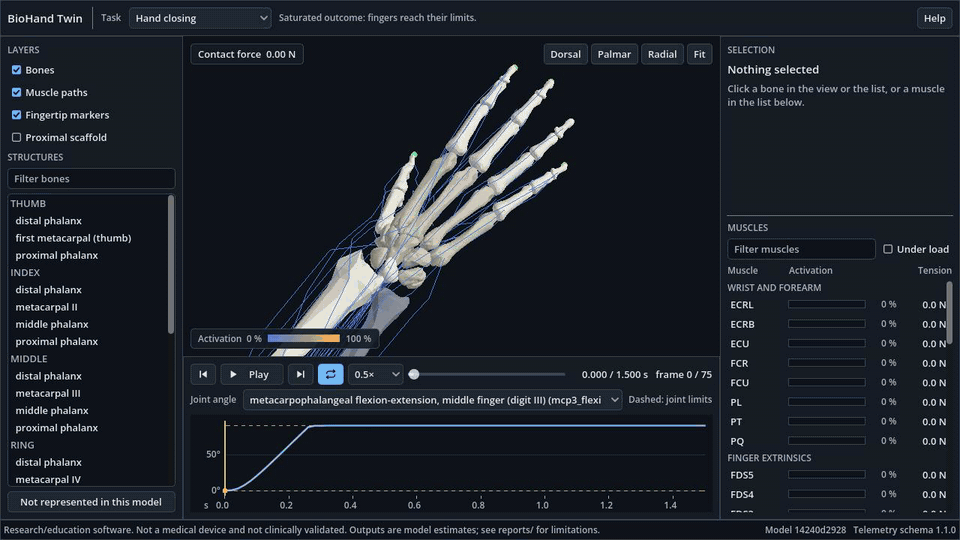

# BioHand Twin

A musculoskeletal simulation and 3D viewer of the human right hand, wrist and forearm, for **non-commercial research and education**.

> **Not a medical device.** It is a generic model, not patient-specific, and it is not clinically validated. Outputs are model estimates. Read [the limitations](docs/LIMITATIONS.md) before using any result.

[](https://github.com/salmand-dev/BioHand-Twin/actions/workflows/ci.yml)



*Recorded runs played back in the viewer. Rendered from the MoBL-ARMS-derived geometry, which is non-commercial and is not stored in this repository.*

## What it does

- Simulates the hand with **MuJoCo** (23 joints, 44 muscle actuators: 39 from MyoHand, 5 added from published cadaver data), the only physics in the project.
- Runs repeatable tasks from configuration files and records joint angles, activations, muscle forces, tendon lengths and contact forces, with units and provenance.
- Plays recorded runs in a **Godot 4** [viewer](docs/VIEWER_UI.md) with selectable bones and muscles, activation bars, a joint plot, keyboard control and validity warnings. The viewer contains no physics.
- Reports what the model does *not* contain, in the documents and in the viewer.

## Architecture

```text
MyoSim (pinned, not bundled) + BioHand patches (data/patches/)
        |
   MuJoCo model  --->  Python: simulation/, biomechanics/, scripts/
                          |  telemetry JSON/CSV (schemas/)
                          v
   Blender (local GLB) --> Godot viewer (visualisation only)
```

See [ARCHITECTURE.md](docs/ARCHITECTURE.md) and [COORDINATE_SYSTEM.md](docs/COORDINATE_SYSTEM.md).

## Quick start (Windows)

Full steps, including the viewer: [INSTALL_WINDOWS.md](docs/INSTALL_WINDOWS.md).

```bash
py -3.11 -m venv .venv
```

```bash
.venv/Scripts/python.exe -m pip install -r requirements-lock.txt
```

```bash
.venv/Scripts/python.exe -m pip install --no-deps -e .
```

```bash
git clone https://github.com/MyoHub/myo_sim.git third_party/myo_sim
```

```bash
git -C third_party/myo_sim checkout 93b0ca8f4ec90c9899ee7f05fee561e9911da91b
```

```bash
.venv/Scripts/python.exe -m pytest -v
```

Use the API:

```python
from simulation.api import BioHandSession

session = BioHandSession()
session.reset({"mcp2_flexion_r": 0.5})          # radians, range-checked
session.set_controls({"FDP2_r": 0.4})           # excitation 0..1
session.step(250)
frame = session.frame()                         # valid against schemas/telemetry_frame.schema.json
```

**The 3D viewer needs a local build,** because its bone geometry is non-commercial and not in this repository. Follow [INSTALL_WINDOWS.md](docs/INSTALL_WINDOWS.md), section 5.

Or the command line: `scripts/biohand.py list-tasks | inventory | run-task <id>`. Tasks and what they show: [DEMO_SCENARIOS.md](docs/DEMO_SCENARIOS.md).

## The model

MyoHand from [MyoSim](https://github.com/MyoHub/myo_sim), pinned to commit `93b0ca8f`, plus five documented patches applied at build time. Upstream files are never edited.

| Patch | What it changes | Basis | Status |
|---|---|---|---|
| `wrist_rom_v1` | Wrist flexion ±70°; deviation 25° ulnar / 10° radial | MoBL-ARMS source values | provisional |
| `muscle_fixes_v1` | EDC5 force; RI2 path; `lengthrange` of 8 muscles | Source value; consistency with sibling muscles; MuJoCo's definition | provisional |
| `limit_stiffness_v1` | Joint-limit stiffness | Numerical setting (2 × timestep), not physiology | provisional |
| `thumb_intrinsics_v1` | Adds APB, FPB (2 heads), ADP (2 heads) | One cadaver specimen (Mirakhorlo et al. 2016), mapped by rule; force = PCSA × specific tension | provisional |
| `passive_stiffness_v1` | Joint springs | Measured for wrist, forearm, index MCP; **assumed** for the thumb; **estimated** for MCP 3–5 | provisional |

`moment_arm_calibration_v1` is optional and off by default: it is **tuned** to the validation data, so it is not validation.

## What the evidence shows

Results from [the phase reports](docs/PHASE_LOG.md):

- **Verified as software:** forward kinematics matches an independent implementation; inverse dynamics matches forward dynamics; tasks repeat bit for bit; viewer poses match MuJoCo.
- **Compared with published data** ([P8 report](reports/P8/P8_REPORT.md)): wrist moment arms have the right sign for 12 of 12 measured values, but only 8 of 12 are within 2 SD, and most are overestimated. Index MCP values agree in 10 of 12 comparisons.
- **Tasks:** 8 of 8 pass their numerical criteria, with caveats. The `pinch` task reaches only about 0.8 N, is unsteady and is fragile against small parameter changes. The `rest_neutral` task passes at 4 s and fails at the original 2 s. See [the fixes report](reports/fixes/FIXES_REPORT.md).
- **Not validated:** forces, timing, EMG and motion trajectories. Tested on one Windows machine only.

## Repository map

- `simulation/`: model loading, patches, kinematics, muscles, tasks, API, extension point.
- `biomechanics/`: coordinate frames and rigid-body math.
- `data/`: glossary, patches, task configurations, validation references, provenance.
- `schemas/`: versioned telemetry format.
- `scripts/`: audits, evidence generation (`reproduce_all.py`) and the CLI.
- `godot_app/`: viewer. `blender/`: asset pipeline and visual-to-physics mapping.
- `docs/`: specifications and analysis. `reports/`: evidence per phase. `tests/`: test suite.
- `third_party/`, `build/`, `godot_app/local_assets/` (gitignored): upstream models and local builds, never committed.

## Status

Version 0.1.0 is a candidate, tested on **one Windows machine**. Linux and other machines are untested; CI is set up to check them. Contributions: [CONTRIBUTING.md](CONTRIBUTING.md).

## Licence and required citations

- BioHand's own code is under the [MIT licence](LICENSE).
- **That licence does not cover the model data.** MyoHand is derived from the **MoBL-ARMS** model, which is licensed for **non-commercial use only**. Commercial use needs a commercial licence from its owners. No MyoSim or SimTK file is included here. See [the licence report](docs/P1_LICENSE_AND_PROVENANCE.md) and [third-party notices](docs/THIRD_PARTY_NOTICES.md).
- Publications using this software with the model **must cite** Saul et al. 2015 and McFarland et al. 2019 (MoBL-ARMS licence terms). See [CITATION.cff](CITATION.cff) and [REFERENCES.md](docs/REFERENCES.md).
